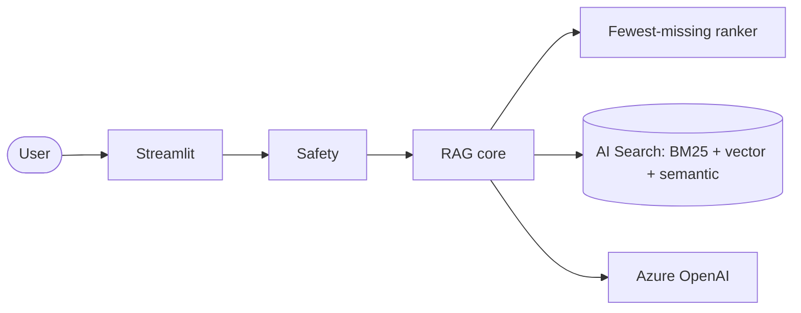

# 🍳 The RAG Cookbook — Sous-chef

[](https://github.com/silent-vector-26/sous-chef-rag-cookbook/actions/workflows/ci.yml)

A recipe RAG app **and** a technical cookbook of RAG techniques, built on Azure AI Search + Azure OpenAI.

- 🥕 **Cook with what you have** — "I have chicken, potatoes and carrots" → recipes ranked by the *fewest ingredients you still need to buy*, with a shopping list and "buy X to unlock N more recipes" tips.
- 💬 **Ask the cookbook** — grounded answers with citations (book + page) and an honest "I don't know".
- 📸 **Fridge photo** (multimodal) and 🧭 **research agent** (tool-calling agentic RAG).
- 🛡️ Prompt Shields / Content Safety, Entra-only auth, evaluation harness, `azd` deploy.


Full requirements and diagrams: [`docs/SRS.md`](docs/SRS.md). Design and decisions: [`docs/SDD.md`](docs/SDD.md).

## Quick start (offline, no Azure needed)
```powershell
pip install -e ".[ui,dev]"
python -m ingest.build_dataset
python -m ragcookbook.cli cook "I have chicken, potatoes and carrots"
python -m ragcookbook.cli ask "how do I make carbonara"
streamlit run app/streamlit_app.py
pytest
python -m eval.run_eval
```
Sample output:
```
You have: chicken, potato, carrot
Roast Chicken with Potatoes and Carrots  [3/5]  missing: onion, thyme
Honey Mustard Chicken and Carrots        [2/4]  missing: honey, mustard
...
```

## Azure mode
```powershell
azd up                              # OpenAI, AI Search, Content Safety, App Insights, Container App + RBAC
copy .env.example .env              # set BACKEND=azure and endpoints from `azd env get-values`
pip install -e ".[azure,ui]"
python -m ingest.index_azure        # create index + upload embeddings
streamlit run app/streamlit_app.py
```
You need RBAC on your own identity for local runs: *Cognitive Services OpenAI User*, *Search Index Data Contributor*, *Search Service Contributor*.
Cost: the default deployment uses the **Free** AI Search tier (50 MB, 3 indexes, one per subscription) and a scale-to-zero Container App, so idle cost is near zero (only Container Registry, ~$5/month). For production-grade capacity set `searchSku` to `basic` (~$73/month).

## The cookbook (one technique per recipe)
| # | Recipe |
|---|---|
| 01 | [Chunking & structured extraction](cookbook/01-chunking-and-extraction.md) |
| 02 | [Hybrid search](cookbook/02-hybrid-search.md) |
| 03 | [Semantic reranking](cookbook/03-semantic-reranking.md) |
| 04 | [Citations & refusal](cookbook/04-citations-and-refusal.md) |
| 05 | [Ingredient search & domain ranking](cookbook/05-ingredient-search.md) |
| 06 | [Multimodal](cookbook/06-multimodal.md) |
| 07 | [Agentic RAG](cookbook/07-agentic-rag.md) |
| 08 | [Evaluation](cookbook/08-evaluation.md) |
| 09 | [Safety](cookbook/09-safety.md) |

## Evaluation (offline baseline)
| metric | local |
|---|---|
| retrieval recall@5 / MRR | 1.00 / 1.00 |
| citation accuracy | 1.00 |
| refusal on unanswerable | 1.00 |
| pantry top-1 / sorted by missing | 1.00 / 1.00 |

The sample set is small by design; add your own cases to `eval/golden.json` and record Azure (hybrid + semantic) results next to it.

## Data
`data/recipes.raw.json` contains 25 classic recipes written in original wording (no copyrighted text). To scale up, ingest public-domain cookbooks (e.g. Project Gutenberg) and use `python -m ingest.build_dataset --llm` for structured extraction; check each source's license.

## Contributing & license
See [CONTRIBUTING.md](CONTRIBUTING.md), [SECURITY.md](SECURITY.md) and [CHANGELOG.md](CHANGELOG.md). Released under the [MIT License](LICENSE).

## Layout
`docs/` SRS + SDD · `src/ragcookbook/` core · `ingest/` dataset + index · `app/` UI · `eval/` metrics · `cookbook/` recipes · `infra/` Bicep · `tests/`

> Deployed and smoke-tested live on Azure (`azd up`-style flow: `azd provision`, `azd deploy`, `python -m ingest.index_azure`): hybrid search, ingredient ranking and grounded Q&A with refusal work against `gpt-5.4-mini`. If AI Search has no capacity in your region, set `azd env set AZURE_SEARCH_LOCATION <region>`. The vision and agent tabs and the full Azure eval run were not re-verified live.
