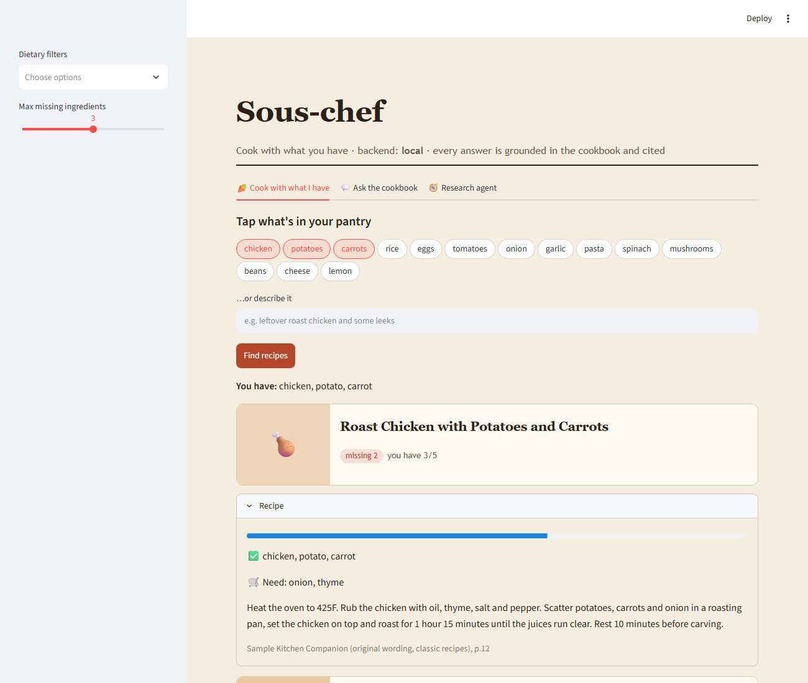
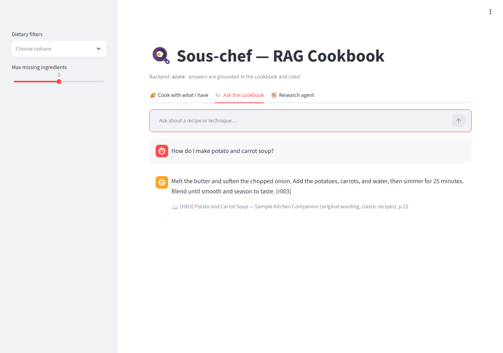
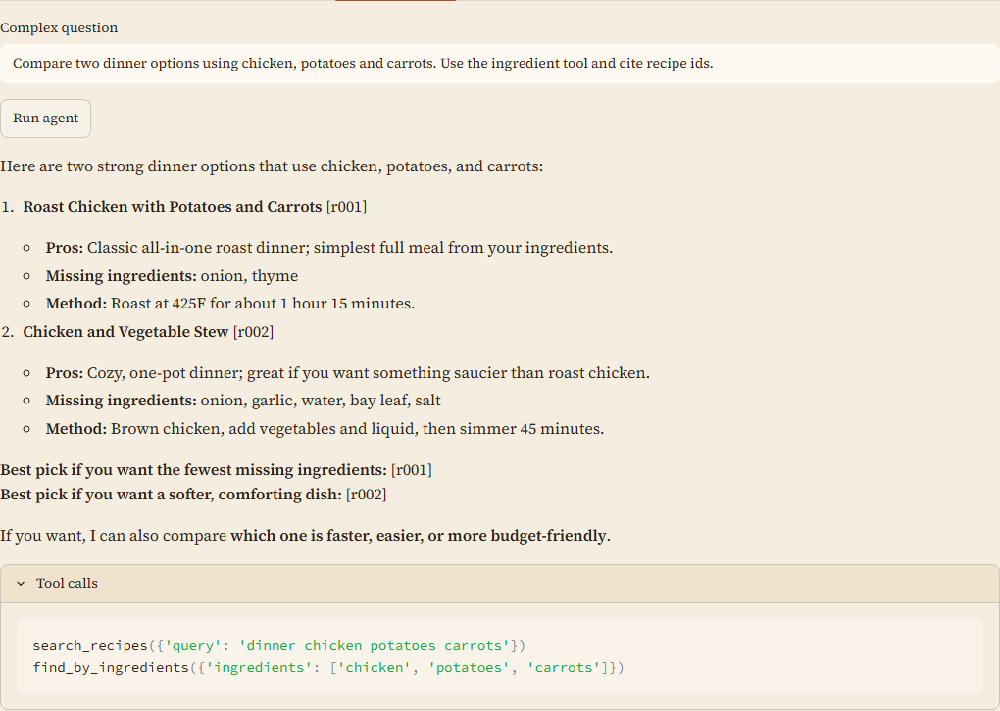
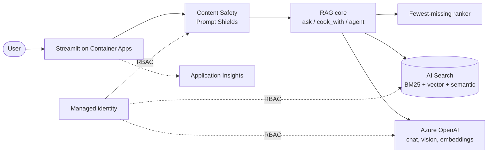

# 🍳 The RAG Cookbook — Sous-chef

[](https://github.com/silent-vector-26/sous-chef-rag-cookbook/actions/workflows/ci.yml)

A recipe RAG app **and** a technical cookbook of RAG techniques, built on Azure AI Search + Azure OpenAI.

- 🥕 **Cook with what you have** — "I have chicken, potatoes and carrots" → recipes ranked by the *fewest ingredients you still need to buy*, with a shopping list and "buy X to unlock N more recipes" tips.
- 💬 **Ask the cookbook** — grounded answers with citations (book + page) and an honest "I don't know".
- 📸 **Fridge photo** (multimodal) and 🧭 **research agent** (tool-calling agentic RAG).
- 🛡️ Prompt Shields / Content Safety, Entra-only auth, evaluation harness, `azd` deploy, CI/CD with GitHub Actions + OIDC.

**▶ Live demo:** https://ca-sous-chef-pqx3s64cfzndu.grayocean-96ef41ba.eastus2.azurecontainerapps.io — it scales to zero to keep costs near nothing, so the first load after idle can take up to a minute.

| Cook with what you have | Ask the cookbook | Research agent |
|---|---|---|
|  |  |  |


Full requirements and diagrams: [`docs/SRS.md`](docs/SRS.md). Design and decisions: [`docs/SDD.md`](docs/SDD.md). Project write-up: [`docs/WRITEUP.md`](docs/WRITEUP.md).

## Design decisions (and the Azure AI skills they show)
| Decision | Why | Skill area |
|---|---|---|
| Hybrid retrieval (BM25 + vector) with the semantic ranker | Keyword exactness plus semantic recall, calibrated rerank score | Azure AI Search, RAG |
| Ingredient ranking in deterministic code, LLM only parses the pantry text | Exact, testable ordering; zero tokens for the core feature | RAG design, cost control |
| Grounded prompt + citations + refusal enforced twice | Trustworthy answers, honest "I don't know" | Responsible AI, grounding |
| Prompt Shields and harm categories before retrieval | Defends against prompt injection | Azure AI Content Safety |
| Tool-calling agent with a visible trace | Agentic RAG that can be inspected | Agents, function calling |
| Vision input for fridge photos | Multimodal extraction | Azure OpenAI (vision) |
| Entra ID only (no keys), managed identity, RBAC | Zero secrets in repo or config | Azure security |
| Golden-set evaluation harness, run against local and live backends | Measurable quality, regression safety | Evaluation |
| Free AI Search tier + scale-to-zero Container Apps | About $5/month idle | Cost optimization |
| Bicep + `azd` + GitHub Actions OIDC deploy | Reproducible, keyless delivery | IaC, CI/CD |

## Quick start (offline, no Azure needed)
```powershell
pip install -e ".[ui,dev]"
python -m ingest.build_dataset
python -m ragcookbook.cli cook "I have chicken, potatoes and carrots"
python -m ragcookbook.cli ask "how do I make carbonara"
streamlit run app/streamlit_app.py
pytest
python -m eval.run_eval
```
Sample output:
```
You have: chicken, potato, carrot
Roast Chicken with Potatoes and Carrots  [3/5]  missing: onion, thyme
Honey Mustard Chicken and Carrots        [2/4]  missing: honey, mustard
...
```

## Azure mode
```powershell
azd up                              # OpenAI, AI Search, Content Safety, App Insights, Container App + RBAC
copy .env.example .env              # set BACKEND=azure and endpoints from `azd env get-values`
pip install -e ".[azure,ui]"
python -m ingest.index_azure        # create index + upload embeddings
streamlit run app/streamlit_app.py
```
You need RBAC on your own identity for local runs: *Cognitive Services OpenAI User*, *Search Index Data Contributor*, *Search Service Contributor* (the deployed app itself only gets *Search Index Data Reader*).
Cost: the default deployment uses the **Free** AI Search tier (50 MB, 3 indexes, one per subscription) and a scale-to-zero Container App, so idle cost is near zero (only Container Registry, ~$5/month). For production-grade capacity set `searchSku` to `basic` (~$73/month).

### CI/CD

Every merge to `main` runs `ci` (tests, eval, Bicep build). When it passes, `deploy` (`.github/workflows/deploy.yml`) runs `azd provision`, `azd deploy`, re-indexes the recipes and smoke-tests the app URL. It can also be started manually (`gh workflow run deploy.yml`). GitHub authenticates to Azure with OIDC (federated credential, no stored secrets); the target is configured through repository variables (`AZURE_CLIENT_ID`, `AZURE_TENANT_ID`, `AZURE_SUBSCRIPTION_ID`, `AZURE_ENV_NAME`, `AZURE_LOCATION`, `AZURE_RESOURCE_GROUP`, `AZURE_SEARCH_LOCATION`, `AZURE_PRINCIPAL_ID`).

## The cookbook (one technique per recipe)
| # | Recipe |
|---|---|
| 01 | [Chunking & structured extraction](cookbook/01-chunking-and-extraction.md) |
| 02 | [Hybrid search](cookbook/02-hybrid-search.md) |
| 03 | [Semantic reranking](cookbook/03-semantic-reranking.md) |
| 04 | [Citations & refusal](cookbook/04-citations-and-refusal.md) |
| 05 | [Ingredient search & domain ranking](cookbook/05-ingredient-search.md) |
| 06 | [Multimodal](cookbook/06-multimodal.md) |
| 07 | [Agentic RAG](cookbook/07-agentic-rag.md) |
| 08 | [Evaluation](cookbook/08-evaluation.md) |
| 09 | [Safety](cookbook/09-safety.md) |

## Evaluation
Golden set: 20 Q&A cases (13 answerable, 7 must-refuse including 3 prompt-injection attempts) and 5 pantry cases, over a 205-recipe corpus.

| metric | local (offline, stub LLM) | Azure (hybrid + semantic, `gpt-5.4-mini`) |
|---|---|---|
| retrieval recall@5 / MRR | 1.00 / 1.00 | 1.00 / 1.00 |
| citation accuracy | 1.00 | 0.92 (2 runs) |
| refusal on unanswerable / injection | 0.57 (stub can't judge relevance) | 1.00 |
| pantry top-1 / sorted by missing | 1.00 / 1.00 | 1.00 / 1.00 |

Reasoning-model deployments (gpt-5.x) don't accept `temperature`, so LLM-dependent metrics such as citation accuracy can vary slightly between runs. Add your own cases to `eval/golden.json`.

## Data
`data/recipes.raw.json` holds 205 recipes in original wording (no copyrighted text): 25 hand-written classics plus 180 synthetic recipes from `python -m ingest.generate_recipes` (LLM-generated across 15 cuisines/themes; dietary tags derived in code). They are demo data, not tested real-world recipes. `python -m ingest.build_dataset --llm` extracts canonical ingredients with an LLM and caches them in the raw file, so offline and CI builds are deterministic.

## Contributing & license
See [CONTRIBUTING.md](CONTRIBUTING.md), [SECURITY.md](SECURITY.md) and [CHANGELOG.md](CHANGELOG.md). Released under the [MIT License](LICENSE).

## Layout
`docs/` SRS + SDD · `src/ragcookbook/` core · `ingest/` dataset + index · `app/` UI · `eval/` metrics · `cookbook/` recipes · `infra/` Bicep · `tests/`

> Deployed and verified live on Azure: hybrid search, ingredient ranking, grounded Q&A with refusal, the multi-step research agent (tool trace) and fridge-photo ingredient extraction all work against `gpt-5.4-mini`, and the eval harness was run against the live backend (see Evaluation). If AI Search has no capacity in your region, set `azd env set AZURE_SEARCH_LOCATION <region>`.
