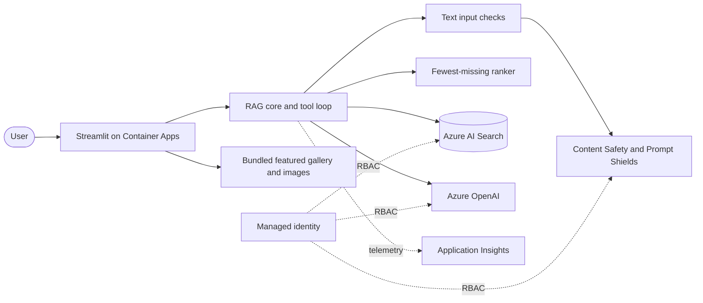

# Sous-chef | The RAG Cookbook

**A recipe assistant that ranks dinner options by what you do not need to buy.**

[](https://github.com/silent-vector-26/sous-chef-rag-cookbook/actions/workflows/ci.yml)
[](https://github.com/silent-vector-26/sous-chef-rag-cookbook/actions/workflows/deploy.yml)
[](pyproject.toml)
[](cookbook/02-hybrid-search.md)
[](LICENSE)

[Live demo](https://ca-sous-chef-pqx3s64cfzndu.grayocean-96ef41ba.eastus2.azurecontainerapps.io) · [Design](docs/SDD.md) · [Requirements](docs/SRS.md) · [Project write-up](docs/WRITEUP.md) · [Technical cookbook](#technical-cookbook)

Sous-chef combines Azure AI Search, Azure OpenAI and deterministic ingredient ranking in a deployed AI engineering portfolio project. It is also a technical cookbook: nine short walkthroughs explain the RAG techniques behind the app.

> **Demo availability:** the Container App scales to zero (`minReplicas: 0`). A first visit after idle can take a minute or longer; retry if the gateway times out. This is a cost-conscious demo, not a production service.


## What you can do

| Workflow | Experience |
|---|---|
| **Cook with what you have** | Select pantry chips or type ingredients. Recipes are ranked by fewest missing ingredients, with a shopping list and single-purchase unlock suggestions. |
| **Explore a recipe** | Expand a photo tile to see owned/missing ingredients, coverage, cooking instructions and source attribution. No separate recipe list. |
| **Ask the cookbook** | Ask cooking questions and get source-linked answers, or a refusal when the cookbook cannot support an answer. |
| **Upload a food photo** | Azure OpenAI extracts visible ingredients and passes them to the same ranker. Available in Azure mode. |
| **Research dinner options** | A bounded tool-calling agent compares recipes and exposes its retrieval-tool trace. Available in Azure mode. |

| Ingredient search and recipe details | Grounded Q&A | Research agent |
|---|---|---|
|  |  |  |

## Engineering highlights

| Design choice | What it demonstrates |
|---|---|
| Hybrid retrieval: BM25, vector search and semantic reranking | Combining exact keyword matching with semantic retrieval |
| Deterministic ranking over retrieved candidates | Domain-specific business logic, explicit tie-breaking and testable behavior |
| Source-constrained Q&A with citations and refusal | Grounding patterns and evaluation of answer support |
| Prompt Shields and harm analysis on screened text paths | Layered input checks; see [scope and limitations](#scope-and-limitations) |
| Vision extraction and tool-calling agent | Multimodal input and inspectable agent orchestration |
| Entra ID, managed identity and role-based access | Keyless Azure service access with a read-only runtime search identity |
| Offline backend, regression tests and golden-set evaluation | Reproducible development with measurable retrieval/ranking behavior |
| Bicep, `azd`, OIDC delivery and OpenTelemetry | Infrastructure, deployment automation and operational visibility |
| Free Search tier and scale-to-zero compute | Explicit cost/performance trade-offs |

## Architecture



Q&A uses hybrid search with semantic reranking. Pantry search instead filters candidates by ingredient overlap, then ranks in Python using `(missing count, -owned count, -retrieval score, title)`. Salt, pepper, water and oil are treated as staples.

The featured gallery reads the bundled cookbook without querying Azure. User searches and answers use the selected backend. See the [SDD](docs/SDD.md) for runtime sequences, ingestion, identity, observability and cost diagrams.

## Run locally

**Prerequisites:** Python 3.10+ and Git. The local backend needs no Azure account, model download or cloud credentials.

```powershell
git clone https://github.com/silent-vector-26/sous-chef-rag-cookbook.git
Set-Location sous-chef-rag-cookbook
python -m venv .venv
.\.venv\Scripts\Activate.ps1
python -m pip install -e ".[ui,dev]"
$env:BACKEND = "local"
python -m ingest.build_dataset
python -m streamlit run app\streamlit_app.py
```

Alternatively, use the CLI:

```powershell
python -m ragcookbook.cli cook "I have chicken, potatoes and carrots"
python -m ragcookbook.cli ask "how do I make carbonara"
```

Local mode uses TF-IDF retrieval, heuristic pantry parsing and extractive answers. It exercises the pipeline and ranking, **not** Azure model quality. Vision and the agent require Azure mode.

## Run on Azure

**Prerequisites:** an Azure subscription, Azure CLI, Azure Developer CLI (`azd`), model quota and permission to provision resources and assign roles.

```powershell
python -m pip install -e ".[azure,ui,dev]"
az login
azd auth login
azd up
Copy-Item .env.example .env
# Edit .env: BACKEND=azure and endpoints from azd env get-values.
$env:BACKEND = "azure"
python -m ingest.index_azure
python -m streamlit run app\streamlit_app.py
```

The deploying principal needs Search Service Contributor and Search Index Data Contributor to create/populate the index, plus the OpenAI and Content Safety data-plane roles for local cloud-backed runs. The deployed app uses managed identity and **Search Index Data Reader**, not search write permissions. RBAC changes can take time to propagate.

If Search capacity is unavailable in your chosen region, configure `azd env set AZURE_SEARCH_LOCATION <region>` before provisioning. Review [security](docs/SDD.md#7-security-design) and [costs](docs/SDD.md#9-cost-optimization) before deployment.

### Cost and teardown

- The demo defaults to AI Search **Free** (50 MB, three indexes; one Free service per subscription) and `minReplicas: 0`.
- The estimated idle baseline is **about USD 5/month**, mainly ACR Basic. This is an estimate, not a guaranteed bill; model calls, builds, storage and telemetry can add charges.
- The 205 recipe images were generated once offline and bundled as WebP files. Viewing them does not call an image model; exact generation spend was not measured.
- Optional budget alerts are enabled with `AZURE_BUDGET_EMAIL`. Alerts notify; they **do not cap spending**.
- Tear down the demo with `azd down --purge`. This deletes the deployed resources, including the search index.

For production, consider a paid Search tier and `minReplicas: 1`, alongside the additional security and quality work listed below. These are recommendations, not the current demo settings.

### CI/CD

Pull requests run tests (including Streamlit UI regressions), the local evaluator and a Bicep build. A merge to `main` runs CI again; successful push-triggered CI starts [deployment](.github/workflows/deploy.yml): provision, container deploy, recipe indexing and an HTTP availability check. The HTTP check alone does not verify interactive workflows.

Azure authentication uses GitHub OIDC, with no stored Azure client secret. Configure the repository variables documented in [SDD §8](docs/SDD.md#8-deployment-design). Deployment can also be started manually with `gh workflow run deploy.yml`.

## Evaluation

```powershell
$env:BACKEND = "local"
python -m pytest -q
python -m eval.run_eval
```

The golden set contains **20 Q&A cases** (13 answerable, seven expected refusals including three injection attempts) and **five pantry cases**, over 205 recipes.

| Metric | Local baseline | Previously recorded Azure runs |
|---|---|---|
| Retrieval recall@5 / MRR | 1.00 / 1.00 | 1.00 / 1.00 |
| Expected-source citation rate (`citation_accuracy`) | 1.00 | 0.92 reported |
| Refusal on unanswerable / injection cases | 0.57 | 1.00 |
| Pantry top-1 / sorted by missing count | 1.00 / 1.00 | 1.00 / 1.00 |
| Expected top recipe's missing count correct | 0.80 | Not recorded in this summary |

These are small, demo-specific measurements, not general benchmarks. `citation_accuracy` checks whether an expected recipe appears in the citation list; it does **not** verify every generated claim. The evaluator writes metrics to `eval/results/<backend>.json` and does not enforce quality thresholds. Azure results vary between runs. See [evaluation methodology](cookbook/08-evaluation.md).

## Data and image provenance

The corpus contains 25 hand-written recipes and 180 LLM-generated recipes across 15 cuisines/themes. They are demonstration data, not kitchen-tested recipes or validated dietary guidance.

- `data/recipes.raw.json`: recipe wording and cached canonical ingredients.
- `data/recipes.json`: normalized corpus built by `python -m ingest.build_dataset`.
- `python -m ingest.build_dataset --llm`: optional Azure-assisted extraction, with cached output for subsequent offline builds.
- `app/static/img/`: 205 AI-generated food images, created once with `gpt-image-1-mini` and resized to 512px WebP (about 5.2 MB total).
- `ingest/generate_images.py`: offline generation utility, not a runtime dependency.

Images are illustrative and may not match the instructions exactly. Source names and page numbers are demo attribution metadata, not references to independently verified published cookbooks.

## Scope and limitations

- This is a public portfolio demo, not production-ready or suitable for allergy, nutrition or medical decisions.
- Safety checks cover Q&A text and pantry text parsing when configured. The agent's top-level prompt, its direct search tool and image extraction do not all pass through the same safety gate.
- Dietary controls apply to pantry results and Q&A retrieval, not as a global constraint on the agent or featured gallery. Tags are demo metadata, not certified dietary guarantees.
- With a photo attached, detected ingredients take precedence over typed/chip ingredients; the app does not currently merge both lists.
- Live checks observed an intermittent HTTP 400 during upload, before extraction. It is tracked in [#13](https://github.com/silent-vector-26/sous-chef-rag-cookbook/issues/13); a successful photo run is not evidence that uploads are consistently reliable.
- Free Search capacity, model quota and cold starts can affect availability. The small synthetic corpus limits the strength of the evaluation.

## Technical cookbook

| # | Technique |
|---|---|
| 01 | [Chunking and structured extraction](cookbook/01-chunking-and-extraction.md) |
| 02 | [Hybrid search](cookbook/02-hybrid-search.md) |
| 03 | [Semantic reranking](cookbook/03-semantic-reranking.md) |
| 04 | [Citations and refusal](cookbook/04-citations-and-refusal.md) |
| 05 | [Ingredient search and domain ranking](cookbook/05-ingredient-search.md) |
| 06 | [Multimodal extraction](cookbook/06-multimodal.md) |
| 07 | [Agentic RAG](cookbook/07-agentic-rag.md) |
| 08 | [Evaluation](cookbook/08-evaluation.md) |
| 09 | [Safety and responsible AI](cookbook/09-safety.md) |

## Repository guide

| Path | Contents |
|---|---|
| `app/` | Streamlit UI and bundled recipe images |
| `src/ragcookbook/` | Retrieval, ranking, generation, safety and tracing |
| `ingest/` | Dataset construction, indexing and offline asset generation |
| `eval/` / `tests/` | Golden-set evaluator and automated regression tests |
| `infra/` / `.github/workflows/` | Bicep infrastructure and CI/CD |
| `docs/` / `cookbook/` | Requirements, design, write-up and technical walkthroughs |

## Contributing and license

See [Contributing](CONTRIBUTING.md), [Security](SECURITY.md), [Code of conduct](CODE_OF_CONDUCT.md) and [Changelog](CHANGELOG.md). The project is released under the [MIT License](LICENSE).
