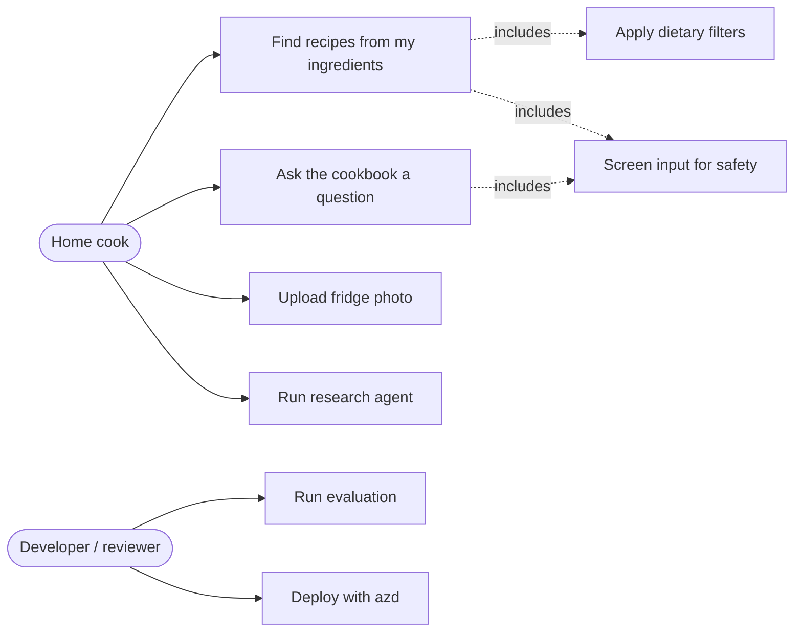
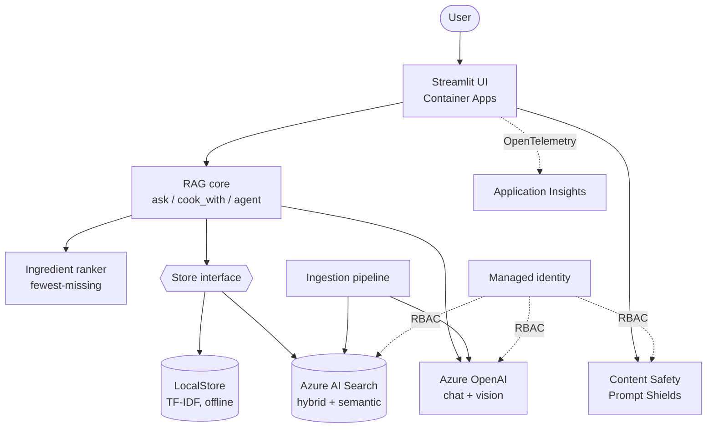
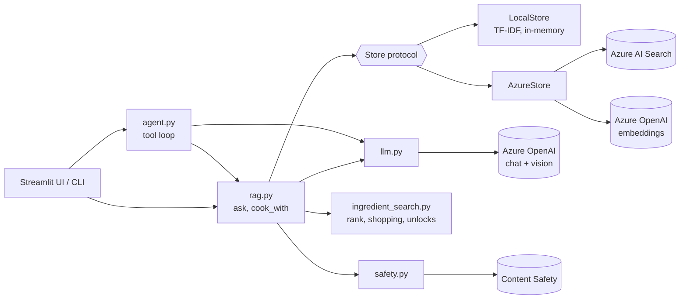
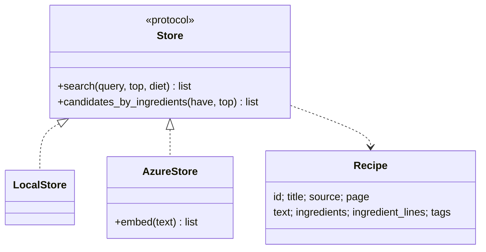
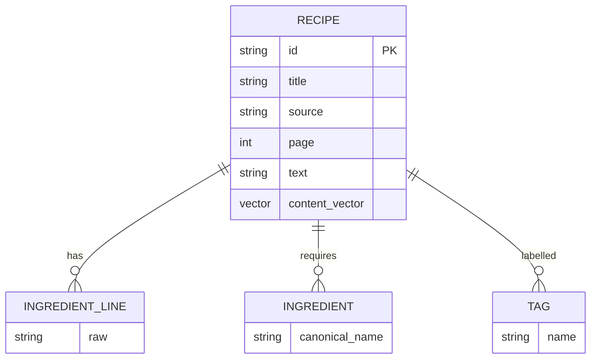
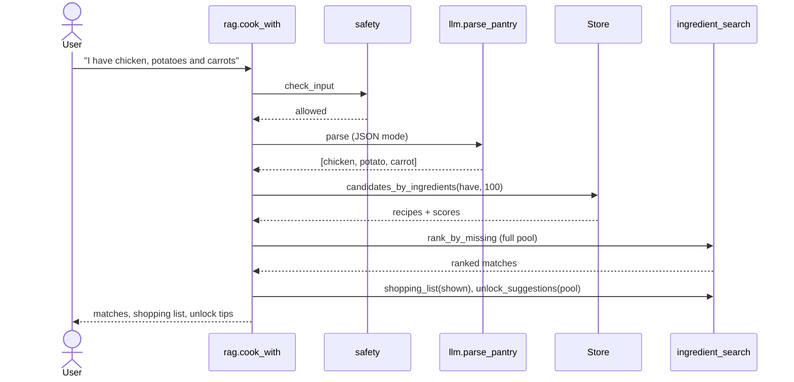
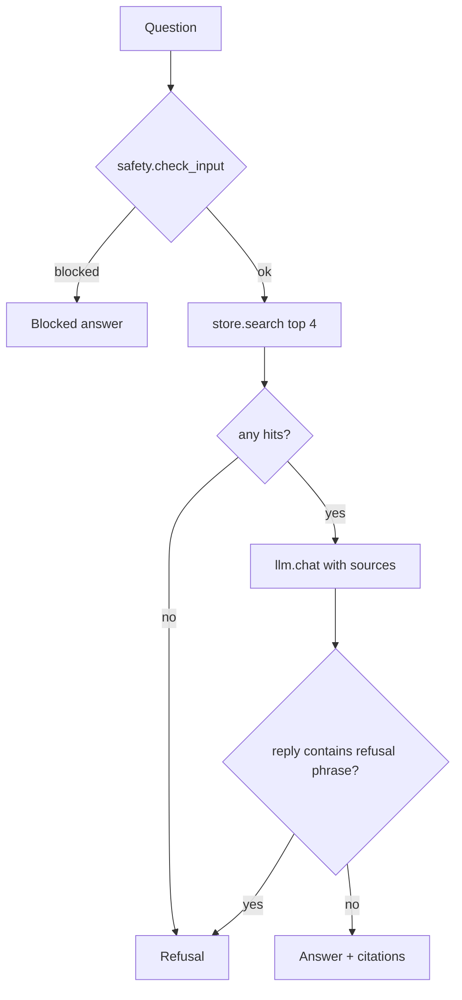
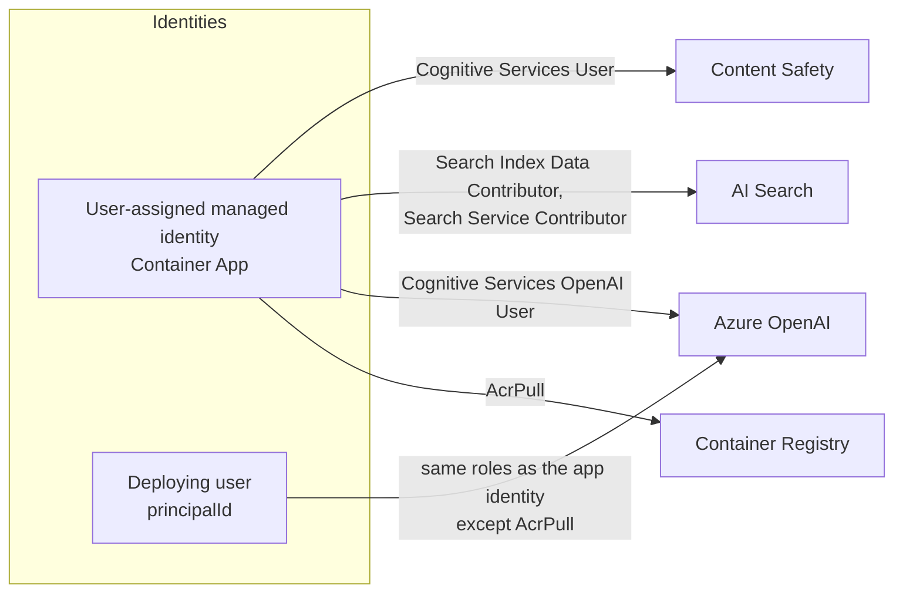
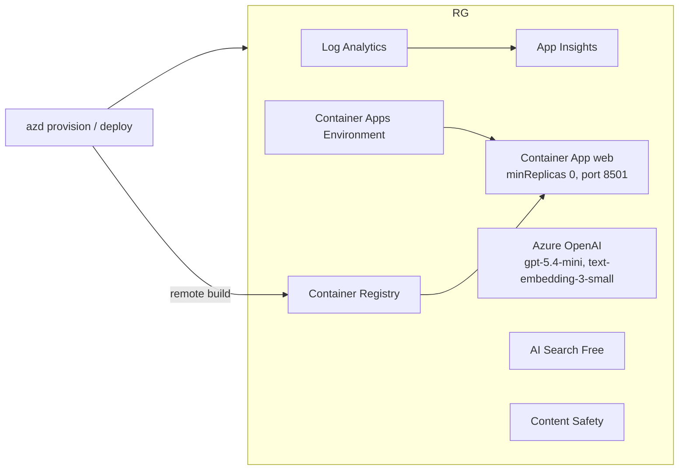

# Software Design Document — Sous-chef (RAG Cookbook)

Companion to the [SRS](SRS.md). The SRS says *what* the system must do; this document says *how* it is built and *why* the design choices were made. Requirement IDs (FR-n / NFR-n) refer to the SRS.

## 1. Design goals

| Goal | Consequence |
|---|---|
| Runs offline for dev/CI (FR-11) | Retrieval sits behind a `Store` protocol with a local and an Azure implementation |
| Keyless security (NFR-1) | Entra ID everywhere; `DefaultAzureCredential`; local auth disabled on every service |
| Trustworthy answers (FR-2, FR-3) | Grounded prompt, citations, refusal path, evaluation harness |
| Deterministic core logic (FR-5) | Ingredient ranking is plain code, not an LLM call |
| Low idle cost (NFR-7) | AI Search Free tier, Container Apps scale to zero |

## 2. Architecture overview

### 2.1 Use cases



### 2.2 System context



### 2.3 Component view



The backend is chosen once by `config.backend()` (`BACKEND=local|azure`) and `store.get_store()`. No other module branches on infrastructure except `rag.ask` (extractive offline answer vs. LLM answer) and `safety.py`/`llm.py` (heuristic vs. service).

## 3. Module design

| Module | Responsibility | Key interface |
|---|---|---|
| `models.py` | Dataclasses `Recipe`, `Citation`, `Answer`, `Match` | — |
| `config.py` | Reads env / `.env`; selects backend | `backend()`, `get(key, default)` |
| `normalize.py` | Canonical ingredient names: lowercase, singularize, fold synonyms, drop quantities | `normalize(name)`, `normalize_list` |
| `extract.py` | Heuristic ingredient extraction from recipe text (ingestion) | `extract_ingredients` |
| `store.py` | Retrieval abstraction and both implementations | `Store.search`, `Store.candidates_by_ingredients` |
| `ingredient_search.py` | Ranking by missing ingredients, shopping list, unlock tips | `rank_by_missing`, `shopping_list`, `unlock_suggestions` |
| `rag.py` | Orchestrates safety, retrieval and generation | `ask`, `cook_with` |
| `llm.py` | Azure OpenAI calls: pantry parsing (JSON mode), ingredient extraction, image ingredient extraction | `chat`, `parse_pantry`, `describe_image_ingredients` |
| `agent.py` | Tool-calling loop over `search_recipes` and `find_by_ingredients`, returns a tool trace | `run_agent` |
| `safety.py` | Prompt Shields + harm categories (Azure) or regex heuristic (local) | `check_input` |
| `ingest/` | `build_dataset.py` builds `data/recipes.json`; `index_azure.py` creates the index and uploads embedded documents | CLI |
| `eval/run_eval.py` | Golden-set metrics | CLI |



## 4. Key design decisions

| # | Decision | Alternatives | Rationale |
|---|---|---|---|
| D1 | Ingredient ranking is deterministic code over retrieved candidates | Ask the LLM to rank | FR-5 and NFR-4 demand exact ordering; code is testable and free of hallucination. The LLM is only used to *parse* the pantry text |
| D2 | Ranking key `(len(missing), -len(have), -retrieval_score, title)` | Score-first | Matches the user's goal: cook with the fewest extra purchases; ties favour recipes that use more of what is owned |
| D3 | Staples (salt, pepper, water, oil) never count as missing | Count everything | Avoids useless shopping suggestions |
| D4 | Candidate retrieval uses an OData filter `search.in(i, '…', ',')` over `ingredients`, then ranks in Python | Pure vector search | Guarantees every candidate contains at least one owned ingredient; keeps ranking independent of embedding quality |
| D5 | Hybrid query (BM25 + vector) with semantic reranking for Q&A | Vector only | Keyword exactness for ingredient and technique terms plus semantic recall; the reranker gives a calibrated score |
| D6 | Refusal is enforced twice: local score threshold (`MIN_LOCAL_SCORE`) and an exact refusal phrase in the system prompt, detected in the reply | Prompt only | Defence in depth; refusal returns no citations and `grounded=False` |
| D7 | Citations are derived from `[rNNN]` tags actually present in the reply, falling back to the top hit | Cite all retrieved | Shows only the sources used |
| D8 | Entra-only auth with a user-assigned managed identity | Keys in env vars | NFR-1; no secrets to leak or rotate. `AZURE_CLIENT_ID` makes `DefaultAzureCredential` pick the user-assigned identity |
| D9 | Reasoning-model chat deployment (`gpt-5.4-mini`) with no `temperature` argument | `gpt-4o-mini` | `gpt-4o-mini` is deprecated and cannot be newly deployed; gpt-5.x reasoning models reject `temperature` |
| D10 | AI Search Free tier by default, `searchSku` / `searchLocation` parameters | Basic | NFR-7. Dataset is far below 50 MB. Region is a parameter because capacity varies (eastus2 was exhausted) |
| D11 | Scale-to-zero Container App with remote ACR build | Always-on, App Service | Near-zero idle cost; no local Docker needed for deploy |

## 5. Data design

### 5.1 Logical model



### 5.2 Ingestion pipeline

```mermaid
flowchart LR
    A[Raw recipes JSON / cookbook text] --> B[Extract ingredient lines]
    B --> C{Mode}
    C -->|offline| D[Heuristic extractor]
    C -->|--llm| E[LLM structured extraction]
    D --> F[Normalize: singular, synonyms]
    E --> F
    F --> G[recipes.json]
    G --> H[Embed title + ingredients + method]
    H --> I[(AI Search index<br/>text, ingredients[], tags[], vector)]
```

### 5.3 Search index schema

Search index `recipes` (created by `ingest/index_azure.py`):

| Field | Type | Attributes |
|---|---|---|
| `id` | String | key |
| `title` | String | searchable |
| `source` | String | filterable |
| `page` | Int32 | filterable |
| `text` | String | searchable |
| `ingredients` | Collection(String) | searchable, filterable (canonical names) |
| `ingredient_lines` | Collection(String) | display only |
| `tags` | Collection(String) | searchable, filterable (diet filters) |
| `content_vector` | Collection(Single), 1536 dims | HNSW profile `hnsw-profile` |

- **Embedding input:** `"{title}. Ingredients: {…}. {text}"` using `text-embedding-3-small`.
- **Semantic configuration:** `recipes-semantic` (title → `title`, content → `text`, keywords → `ingredients`).
- **Offline equivalent:** `LocalStore` builds an in-memory TF-IDF over the same fields from `data/recipes.json`.

## 6. Runtime design

### 6.1 Ingredient search (`rag.cook_with`)



Unlock tips are computed over the full ranked pool, then the display list is trimmed to `limit`, so a suggestion can point at recipes not currently shown.

### 6.2 Grounded Q&A (`rag.ask`)



### 6.3 Agent (`agent.py`)

A bounded tool-calling loop: the model may call `search_recipes` or `find_by_ingredients`, results are fed back, and the loop ends on a final message or the step limit. Every tool call is recorded and shown in the UI as the trace.

## 7. Security design



- `disableLocalAuth: true` on OpenAI, Search and Content Safety; ACR admin user disabled.
- The app identity and the deploying user hold the same data-plane roles (OpenAI User, Search Index Data Contributor, Search Service Contributor, Cognitive Services User); the app additionally has AcrPull. Contributor rights are broader than strictly needed at runtime. Splitting out a read-only runtime role (Search Index Data Reader) is a possible hardening step.
- Prompt injection: input screened by Prompt Shields; the system prompt tells the model to ignore instructions embedded in sources or the question.
- User-supplied values interpolated into OData filters are quote-escaped (`_esc`).
- No secrets in the repo; `.env.example` holds only endpoints and deployment names.

## 8. Deployment design



- Single Bicep template at resource-group scope (`infra/main.bicep`), parameters mapped in `infra/main.parameters.json`.
- Parameters: `location`, `aiLocation`, `searchLocation`, `searchSku` (`free` default), `principalId`.
- Deploy flow: `azd provision` → `azd deploy` → `python -m ingest.index_azure` (needs the deployer RBAC roles; propagation can take minutes).
- CI/CD: a merge to `main` triggers `ci`; on success `deploy.yml` (`workflow_run`) logs in with GitHub OIDC to an Entra app (`gh-sous-chef-deploy`, federated credential for `refs/heads/main`, Owner on the resource group so Bicep can create role assignments), then runs the same provision → deploy → index steps plus an HTTP smoke test. Deploys are serialized (`concurrency`), and `principalType` is `ServicePrincipal` in CI so the pipeline identity also gets the data-plane roles needed for indexing. Hardening option: replace Owner with Contributor + Role Based Access Control Administrator.
- Reference cost: see §9 (Cost optimization).

## 9. Cost optimization

Prices are Azure retail pay-as-you-go (USD) at the time of writing; verify on the Azure pricing calculator.

### 9.1 Cost drivers

| Resource | Billing model | Basic-tier baseline | Current design | Idle cost |
|---|---|---|---|---|
| Azure AI Search | Per hour per search unit | Basic: $0.10/h ≈ $73/month | **Free** tier (`searchSku=free`) | $0 |
| Container Registry | Per day + storage | Basic: ~$0.167/day ≈ $5/month | Basic, no admin user | ~$5/month |
| Container Apps | Per-second vCPU/memory + requests; monthly free grant | Always-on replica ≈ $5–15/month | `minReplicas: 0` (scale to zero) | ~$0 |
| Azure OpenAI | Per token | Pay per use | `gpt-5.4-mini` + `text-embedding-3-small`, GlobalStandard/Standard | $0 when unused |
| Content Safety | Per 1,000 text records | Pay per use | Called once per user input | $0 when unused |
| Log Analytics / App Insights | Per GB ingested, 5 GB/month free | Pay per use | 30-day retention, demo volume | $0 |
| Managed identity, RBAC | Free | — | — | $0 |

Result: the deployment costs about **$5/month idle** (versus about $78–80 with Search Basic) and cents per demo session.

### 9.2 Optimization decisions

| # | Measure | Effect | Trade-off |
|---|---|---|---|
| C1 | AI Search Free tier by default | Removes the largest cost (~90%) | 50 MB, 3 indexes, shared capacity, no SLA, ~1,000 semantic queries/month, deleted after 90 days idle; cannot be upgraded in place |
| C2 | Container App scales to zero | No compute cost while idle | Cold start on the first request (a gateway timeout is possible) |
| C3 | Small chat model (`gpt-5.4-mini`) and small embeddings (`text-embedding-3-small`, 1536 dims) | Lowest per-token cost that meets the eval targets | Lower reasoning depth than larger models |
| C4 | Ranking, shopping list and unlock tips in code, not LLM calls | Zero tokens for the core feature, plus determinism | — |
| C5 | Only one LLM call per question or pantry message (agent capped at 5 steps) | Bounded token spend | Agent answers may be cut at the step limit |
| C6 | Only the top 4 sources are put into the prompt | Smaller prompts | Possible recall loss on broad questions |
| C7 | Embeddings are computed once at ingest, not per document at query time (only the query is embedded) | One embedding call per search | Re-ingest needed when the corpus changes |
| C8 | Content Safety is skipped by the offline backend | Free dev/CI | Heuristic only |
| C9 | ACR Basic with remote build | No build agent or Docker needed locally | ~$5/month floor |
| C10 | Single resource group, one `azd down --purge` | Clean teardown between demos | Re-provision and re-index to restore |

### 9.3 Further options

| Option | Saves | When to use |
|---|---|---|
| Delete the registry after deploy and pull from a public image | ~$5/month | Only if the registry is not needed again |
| Lower OpenAI deployment capacity (currently 30) | Nothing directly (pay per token) but limits runaway spend | Always reasonable for demos |
| Azure budget with alerts on the resource group | Prevents surprises | Recommended |
| **Production recommendation:** `searchSku=basic` (or higher) and `minReplicas: 1` | Costs ~$73 + ~$5–15/month more | Removes cold starts, adds replicas/SLA and capacity beyond 50 MB; not needed for the demo |
| Prompt caching and shorter prompts | Fewer input tokens | When traffic grows |
| Cache frequent query embeddings | Fewer embedding calls | When traffic grows |

## 10. Observability design (NFR-6)

OpenTelemetry spans are created by `ragcookbook/tracing.py` (a no-op when the SDK is absent). When `APPLICATIONINSIGHTS_CONNECTION_STRING` is set, `azure-monitor-opentelemetry` exports them to Application Insights, where Azure SDK and HTTP dependency calls appear as children.

| Span | Attributes |
|---|---|
| `rag.ask` | `rag.question_chars`, `rag.diet`, `rag.grounded`, `rag.citations`, `rag.outcome` (answered/refused/blocked) |
| `safety.check_input`, `rag.retrieve` | `rag.top`, `rag.hits` |
| `rag.cook_with` → `rag.candidates`, `rag.rank` | `pantry.items`, `rag.results` |
| `llm.chat` | `gen_ai.request.model`, `gen_ai.usage.input_tokens`, `gen_ai.usage.output_tokens` |
| `agent.run` → `agent.step` → `agent.tool` | `agent.tool_calls`, `agent.tool.name` |

Privacy: spans record sizes, counts, and outcomes only, never raw questions or pantry text.

Useful KQL (Application Insights → Logs):

```kusto
// Latency and outcome by operation
dependencies
| where name startswith "rag." or name startswith "agent." or name == "llm.chat"
| summarize count(), p50=percentile(duration, 50), p95=percentile(duration, 95) by name

// Refusal / block rate
dependencies | where name == "rag.ask"
| summarize n=count() by outcome=tostring(customDimensions["rag.outcome"])

// Token usage per day
dependencies | where name == "llm.chat"
| summarize tokens_in=sum(toint(customDimensions["gen_ai.usage.input_tokens"])),
            tokens_out=sum(toint(customDimensions["gen_ai.usage.output_tokens"])) by bin(timestamp, 1d)
```

## 11. Quality and testing design

```mermaid
flowchart LR
    G[eval/golden.json<br/>QA + pantry cases] --> H[run_eval]
    H --> M1[Recall@5, MRR]
    H --> M2[Citation accuracy]
    H --> M3[Refusal rate]
    H --> M4[Pantry top-1, sort order]
    M1 & M2 & M3 & M4 --> R[eval/results/&lt;backend&gt;.json]
    R --> C[Compare strategies: local vs hybrid vs semantic]
```

| Layer | Approach |
|---|---|
| Unit | `tests/test_core.py`: normalization, pantry parsing, ranking, filters, unlock tips, grounding, injection (offline, deterministic) |
| Evaluation | `eval/run_eval.py` on `eval/golden.json`: recall@k, citation rate, refusal rate, pantry sort correctness (NFR-2…4) |
| CI | GitHub Actions: pytest, eval on the local backend, `az bicep build` |
| Live | `BACKEND=azure python -m eval.run_eval` plus manual checks of the agent and fridge-photo paths against the deployed resources |

## 12. Known limitations and risks

| Item | Impact | Mitigation / next step |
|---|---|---|
| LLM-dependent metrics vary between runs (citation accuracy 0.86–1.00 over 5 runs) because gpt-5.x rejects `temperature` | Flaky eval numbers | Report ranges; add more cases and run several times |
| Free Search tier: shared capacity, no SLA, ~1,000 semantic queries/month, deleted after 90 days idle | Latency variance, possible loss of the index | Re-run `ingest.index_azure`; use `searchSku=basic` for real workloads |
| Scale to zero | Cold-start delay on the first request | Accepted for a demo; `minReplicas` stays 0 (set to 1 only for production use) |
| Corpus is synthetic (205 recipes; 180 LLM-generated) | Metrics are optimistic vs. real-world data | Ingest licensed or public-domain sources via `ingest/build_dataset.py --llm` |
| Heuristic ingredient extraction | Misses unusual phrasing | LLM-assisted extraction at ingest time |

## 13. Traceability (design → requirements)

| Design element | Satisfies |
|---|---|
| `Store` protocol + `LocalStore` | FR-11, NFR-5 |
| D1–D4, `ingredient_search.py` | FR-4, FR-5, FR-6, FR-7, NFR-4 |
| D5–D7, `rag.ask` | FR-2, FR-3, NFR-3 |
| `safety.py`, §7 | FR-10 |
| `llm.describe_image_ingredients` | FR-8 |
| `agent.py` | FR-9 |
| `ingest/`, §5 | FR-1 |
| `eval/run_eval.py`, §11 | FR-12, NFR-2…4 |
| §7 identities and RBAC | NFR-1 |
| App Insights in §8, tracing in §10 | NFR-6 |
| D10, D11, §8, §9 | NFR-7, NFR-8 |
