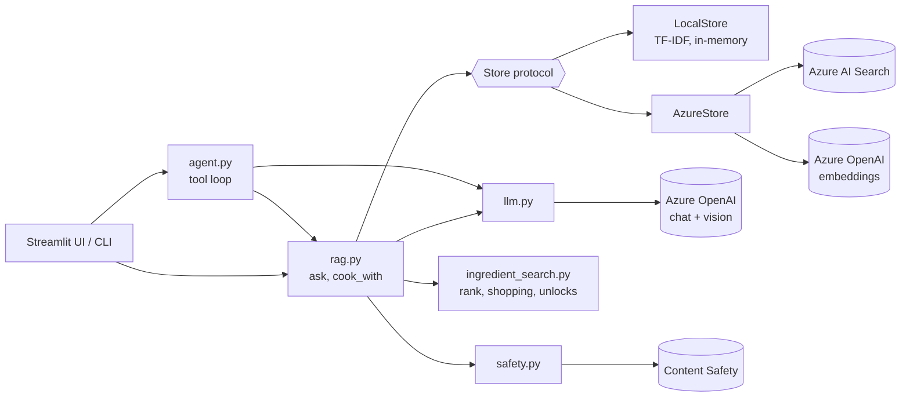
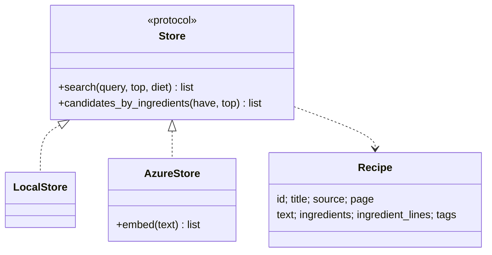
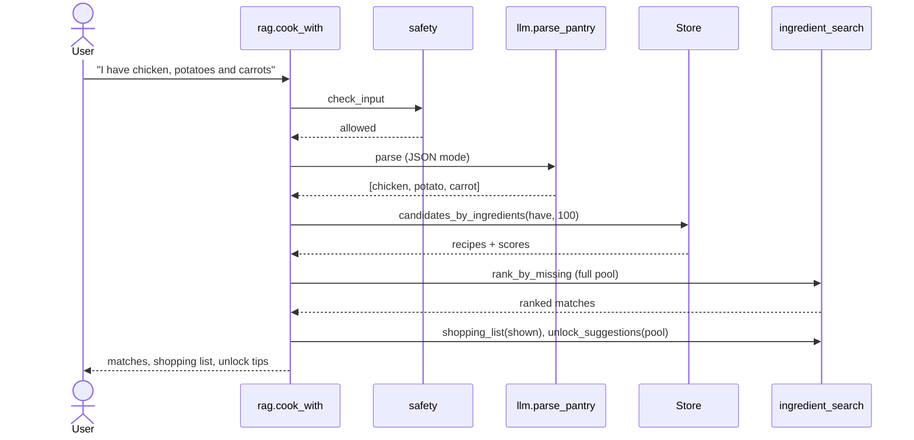
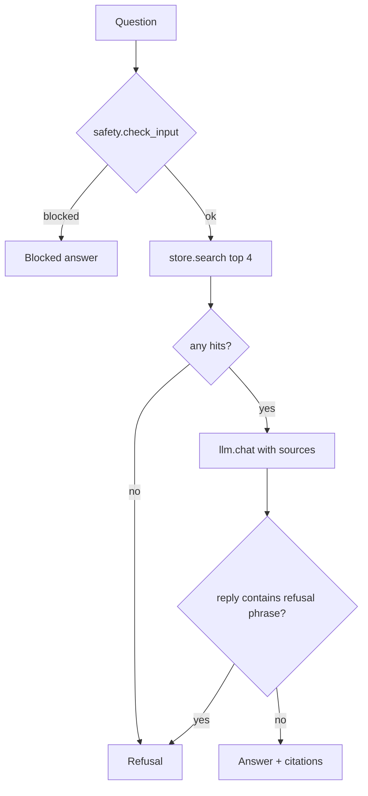
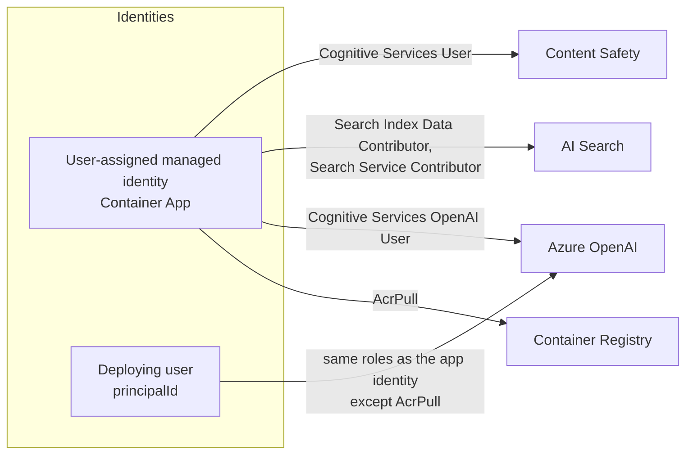
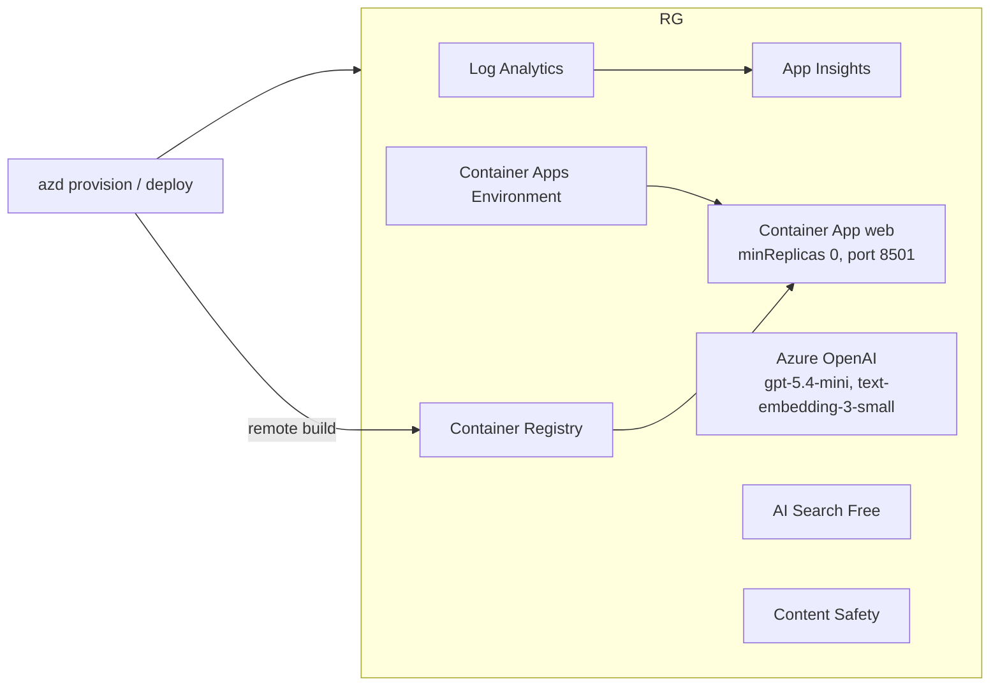

# Software Design Document — Sous-chef (RAG Cookbook)

Companion to the [SRS](SRS.md). The SRS says *what* the system must do; this document says *how* it is built and *why* the design choices were made. Requirement IDs (FR-n / NFR-n) refer to the SRS.

## 1. Design goals

| Goal | Consequence |
|---|---|
| Runs offline for dev/CI (FR-11) | Retrieval sits behind a `Store` protocol with a local and an Azure implementation |
| Keyless security (NFR-1) | Entra ID everywhere; `DefaultAzureCredential`; local auth disabled on every service |
| Trustworthy answers (FR-2, FR-3) | Grounded prompt, citations, refusal path, evaluation harness |
| Deterministic core logic (FR-5) | Ingredient ranking is plain code, not an LLM call |
| Low idle cost (NFR-7) | AI Search Free tier, Container Apps scale to zero |

## 2. Architecture overview

The backend is chosen once by `config.backend()` (`BACKEND=local|azure`) and `store.get_store()`. No other module branches on infrastructure except `rag.ask` (extractive offline answer vs. LLM answer) and `safety.py`/`llm.py` (heuristic vs. service).

## 3. Module design

| Module | Responsibility | Key interface |
|---|---|---|
| `models.py` | Dataclasses `Recipe`, `Citation`, `Answer`, `Match` | — |
| `config.py` | Reads env / `.env`; selects backend | `backend()`, `get(key, default)` |
| `normalize.py` | Canonical ingredient names: lowercase, singularize, fold synonyms, drop quantities | `normalize(name)`, `normalize_list` |
| `extract.py` | Heuristic ingredient extraction from recipe text (ingestion) | `extract_ingredients` |
| `store.py` | Retrieval abstraction and both implementations | `Store.search`, `Store.candidates_by_ingredients` |
| `ingredient_search.py` | Ranking by missing ingredients, shopping list, unlock tips | `rank_by_missing`, `shopping_list`, `unlock_suggestions` |
| `rag.py` | Orchestrates safety, retrieval and generation | `ask`, `cook_with` |
| `llm.py` | Azure OpenAI calls: pantry parsing (JSON mode), ingredient extraction, image ingredient extraction | `chat`, `parse_pantry`, `describe_image_ingredients` |
| `agent.py` | Tool-calling loop over `search_recipes` and `find_by_ingredients`, returns a tool trace | `run_agent` |
| `safety.py` | Prompt Shields + harm categories (Azure) or regex heuristic (local) | `check_input` |
| `ingest/` | `build_dataset.py` builds `data/recipes.json`; `index_azure.py` creates the index and uploads embedded documents | CLI |
| `eval/run_eval.py` | Golden-set metrics | CLI |

## 4. Key design decisions

| # | Decision | Alternatives | Rationale |
|---|---|---|---|
| D1 | Ingredient ranking is deterministic code over retrieved candidates | Ask the LLM to rank | FR-5 and NFR-4 demand exact ordering; code is testable and free of hallucination. The LLM is only used to *parse* the pantry text |
| D2 | Ranking key `(len(missing), -len(have), -retrieval_score, title)` | Score-first | Matches the user's goal: cook with the fewest extra purchases; ties favour recipes that use more of what is owned |
| D3 | Staples (salt, pepper, water, oil) never count as missing | Count everything | Avoids useless shopping suggestions |
| D4 | Candidate retrieval uses an OData filter `search.in(i, '…', ',')` over `ingredients`, then ranks in Python | Pure vector search | Guarantees every candidate contains at least one owned ingredient; keeps ranking independent of embedding quality |
| D5 | Hybrid query (BM25 + vector) with semantic reranking for Q&A | Vector only | Keyword exactness for ingredient and technique terms plus semantic recall; the reranker gives a calibrated score |
| D6 | Refusal is enforced twice: local score threshold (`MIN_LOCAL_SCORE`) and an exact refusal phrase in the system prompt, detected in the reply | Prompt only | Defence in depth; refusal returns no citations and `grounded=False` |
| D7 | Citations are derived from `[rNNN]` tags actually present in the reply, falling back to the top hit | Cite all retrieved | Shows only the sources used |
| D8 | Entra-only auth with a user-assigned managed identity | Keys in env vars | NFR-1; no secrets to leak or rotate. `AZURE_CLIENT_ID` makes `DefaultAzureCredential` pick the user-assigned identity |
| D9 | Reasoning-model chat deployment (`gpt-5.4-mini`) with no `temperature` argument | `gpt-4o-mini` | `gpt-4o-mini` is deprecated and cannot be newly deployed; gpt-5.x reasoning models reject `temperature` |
| D10 | AI Search Free tier by default, `searchSku` / `searchLocation` parameters | Basic | NFR-7. Dataset is far below 50 MB. Region is a parameter because capacity varies (eastus2 was exhausted) |
| D11 | Scale-to-zero Container App with remote ACR build | Always-on, App Service | Near-zero idle cost; no local Docker needed for deploy |

## 5. Data design

Search index `recipes` (created by `ingest/index_azure.py`):

| Field | Type | Attributes |
|---|---|---|
| `id` | String | key |
| `title` | String | searchable |
| `source` | String | filterable |
| `page` | Int32 | filterable |
| `text` | String | searchable |
| `ingredients` | Collection(String) | searchable, filterable (canonical names) |
| `ingredient_lines` | Collection(String) | display only |
| `tags` | Collection(String) | searchable, filterable (diet filters) |
| `content_vector` | Collection(Single), 1536 dims | HNSW profile `hnsw-profile` |

- **Embedding input:** `"{title}. Ingredients: {…}. {text}"` using `text-embedding-3-small`.
- **Semantic configuration:** `recipes-semantic` (title → `title`, content → `text`, keywords → `ingredients`).
- **Offline equivalent:** `LocalStore` builds an in-memory TF-IDF over the same fields from `data/recipes.json`.

## 6. Runtime design

### 6.1 Ingredient search (`rag.cook_with`)

Unlock tips are computed over the full ranked pool, then the display list is trimmed to `limit`, so a suggestion can point at recipes not currently shown.

### 6.2 Grounded Q&A (`rag.ask`)

### 6.3 Agent (`agent.py`)

A bounded tool-calling loop: the model may call `search_recipes` or `find_by_ingredients`, results are fed back, and the loop ends on a final message or the step limit. Every tool call is recorded and shown in the UI as the trace.

## 7. Security design

- `disableLocalAuth: true` on OpenAI, Search and Content Safety; ACR admin user disabled.
- The app identity and the deploying user hold the same data-plane roles (OpenAI User, Search Index Data Contributor, Search Service Contributor, Cognitive Services User); the app additionally has AcrPull. Contributor rights are broader than strictly needed at runtime. Splitting out a read-only runtime role (Search Index Data Reader) is a possible hardening step.
- Prompt injection: input screened by Prompt Shields; the system prompt tells the model to ignore instructions embedded in sources or the question.
- User-supplied values interpolated into OData filters are quote-escaped (`_esc`).
- No secrets in the repo; `.env.example` holds only endpoints and deployment names.

## 8. Deployment design

- Single Bicep template at resource-group scope (`infra/main.bicep`), parameters mapped in `infra/main.parameters.json`.
- Parameters: `location`, `aiLocation`, `searchLocation`, `searchSku` (`free` default), `principalId`.
- Deploy flow: `azd provision` → `azd deploy` → `python -m ingest.index_azure` (needs the deployer RBAC roles; propagation can take minutes).
- Reference cost: Free Search + scale to zero ≈ $5/month idle (Container Registry); Search Basic would add ≈ $73/month.

## 9. Quality and testing design

| Layer | Approach |
|---|---|
| Unit | `tests/test_core.py`: normalization, pantry parsing, ranking, filters, unlock tips, grounding, injection (offline, deterministic) |
| Evaluation | `eval/run_eval.py` on `eval/golden.json`: recall@k, citation rate, refusal rate, pantry sort correctness (NFR-2…4) |
| CI | GitHub Actions: pytest, eval on the local backend, `az bicep build` |
| Live | Manual smoke test against Azure (ingredient ranking, grounded answer, refusal) |

## 10. Known limitations and risks

| Item | Impact | Mitigation / next step |
|---|---|---|
| Azure vision and agent paths not verified live | Possible model-compat issues | Run them and add to the eval |
| Free Search tier: shared capacity, no SLA, ~1,000 semantic queries/month, deleted after 90 days idle | Latency variance, possible loss of the index | Re-run `ingest.index_azure`; use `searchSku=basic` for real workloads |
| Scale to zero | Cold-start delay or gateway timeout on first request | Set `minReplicas: 1` if needed |
| Small sample corpus (25 recipes) | Metrics are optimistic | Extend `ingest/build_dataset.py` with larger public-domain sources |
| Heuristic ingredient extraction | Misses unusual phrasing | LLM-assisted extraction at ingest time |

## 11. Traceability (design → requirements)

| Design element | Satisfies |
|---|---|
| `Store` protocol + `LocalStore` | FR-11, NFR-5 |
| D1–D4, `ingredient_search.py` | FR-4, FR-5, FR-6, FR-7, NFR-4 |
| D5–D7, `rag.ask` | FR-2, FR-3, NFR-3 |
| `safety.py`, §7 | FR-10 |
| `llm.describe_image_ingredients` | FR-8 |
| `agent.py` | FR-9 |
| `ingest/`, §5 | FR-1 |
| `eval/run_eval.py`, §9 | FR-12, NFR-2…4 |
| §7 identities and RBAC | NFR-1 |
| App Insights in §8 | NFR-6 |
| D10, D11, §8 | NFR-7, NFR-8 |
