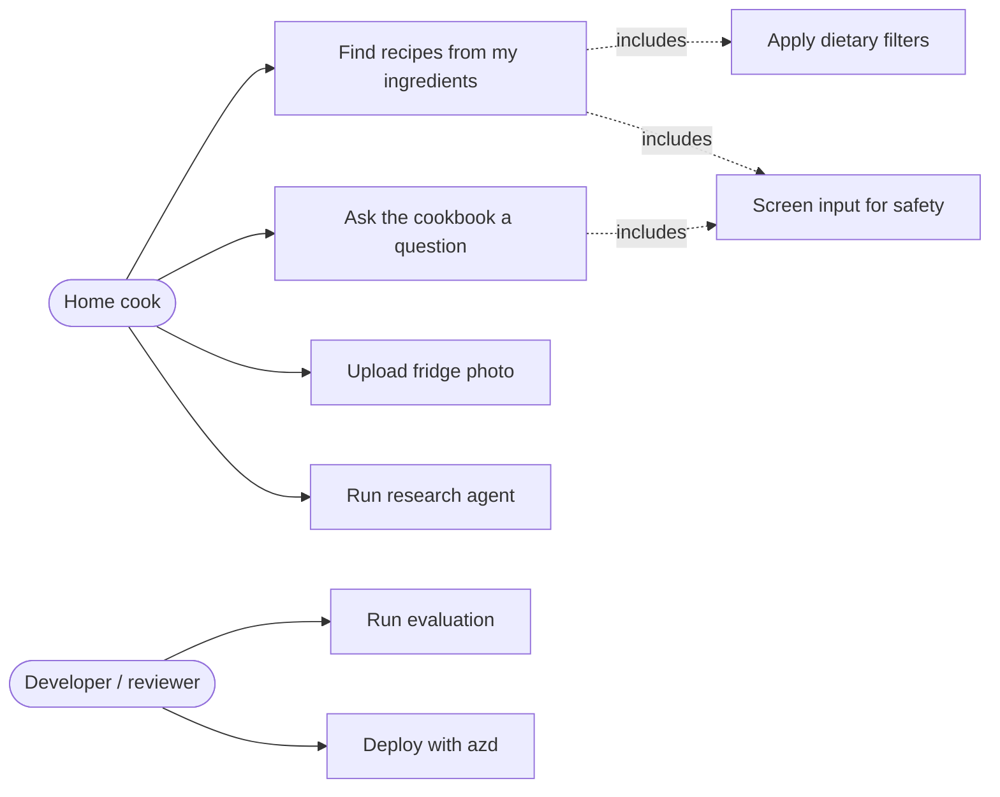
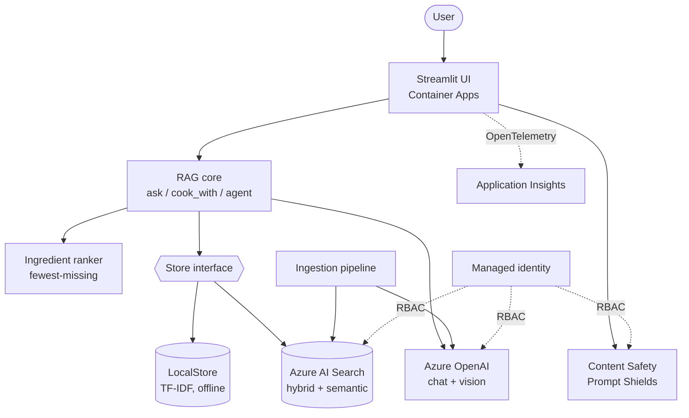
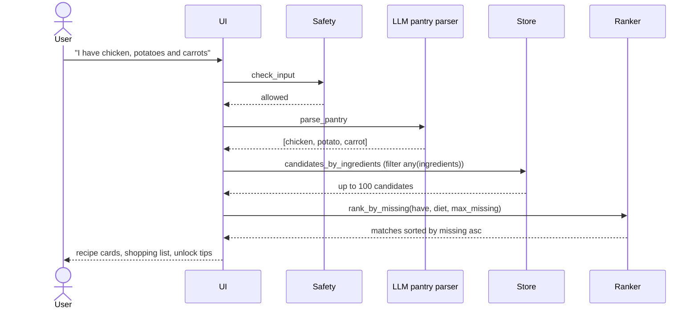
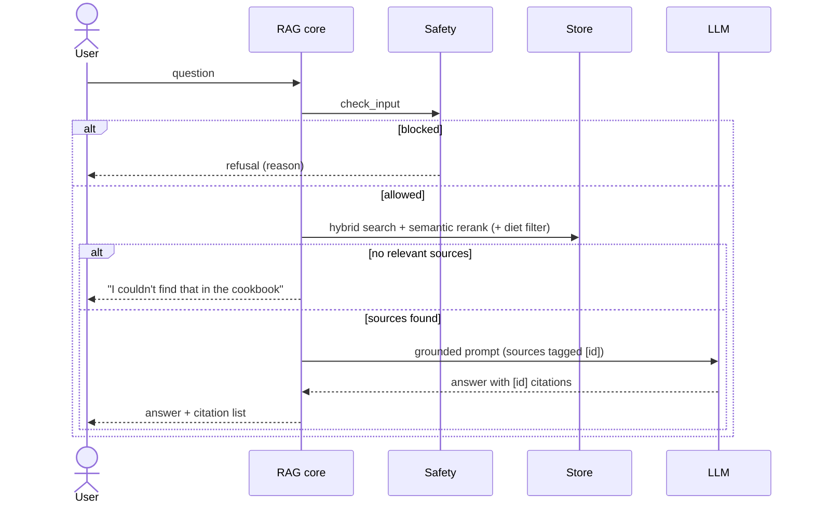
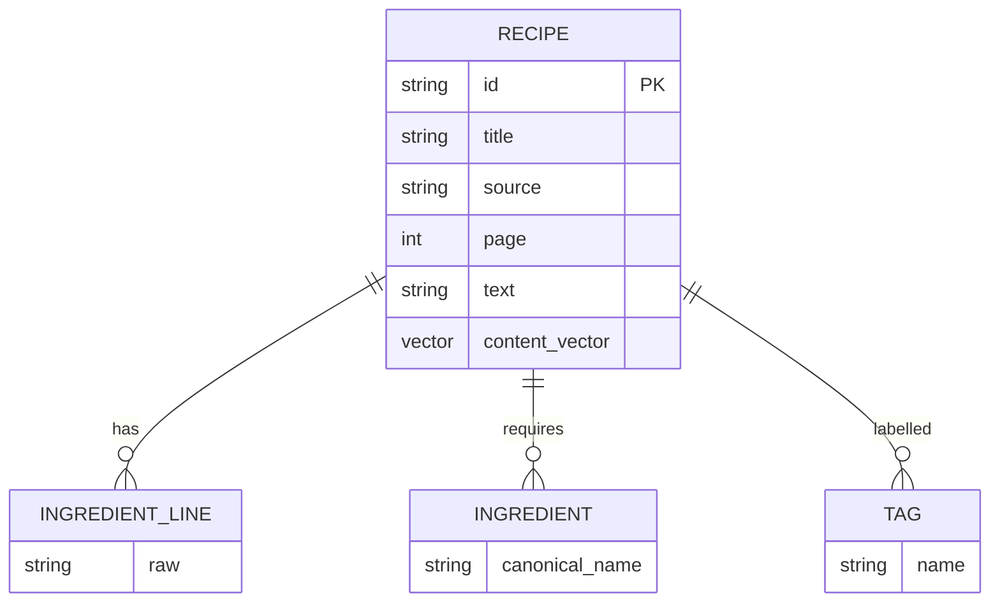
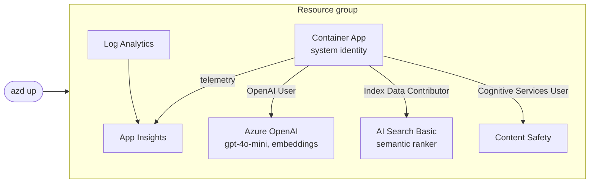

# Software Requirements Specification — Sous-chef (RAG Cookbook)

Version 0.1

## 1. Purpose and scope
Sous-chef is a retrieval-augmented generation (RAG) application over a corpus of public-domain-style cookbooks. It (a) answers cooking questions with citations, and (b) recommends recipes from the ingredients the user has, ranked by the **fewest additional ingredients to buy**. The project doubles as a technical cookbook (`cookbook/`) demonstrating one RAG technique per recipe.

**Out of scope:** user accounts, nutrition/medical advice, grocery ordering, production-scale ingestion.

## 2. Stakeholders and users
| Role | Need |
|---|---|
| Home cook | "What can I make with what I have, and what should I buy?" |
| Hiring manager / reviewer | Evidence of production-grade RAG: retrieval quality, evaluation, safety, deployment |
| Developer | Clear techniques, runnable offline, swappable backends |

## 3. Definitions
- **Pantry**: the normalized list of ingredients the user says (or shows) they have.
- **Staples**: salt, pepper, water, oil — assumed available, never counted as missing.
- **Missing set**: recipe ingredients (excluding staples) not in the pantry.
- **Grounded**: every claim in an answer is supported by retrieved sources.

## 4. Functional requirements
| ID | Requirement |
|---|---|
| FR-1 | The system SHALL ingest recipes, extract canonical ingredient names and store them with source, page, tags and an embedding. |
| FR-2 | The system SHALL answer free-form cooking questions using only retrieved recipe sources and SHALL cite source id, title, book and page. |
| FR-3 | If retrieval yields no sufficiently relevant source, the system SHALL respond that it does not know instead of guessing. |
| FR-4 | The system SHALL parse a natural-language pantry statement (e.g. "I have chicken, potatoes and carrots") into normalized ingredients (singular, synonyms folded). |
| FR-5 | The system SHALL retrieve candidate recipes containing at least one pantry ingredient and rank them by ascending count of missing ingredients; ties are broken by more owned ingredients, then retrieval score. |
| FR-6 | For each recipe the system SHALL show owned vs. missing ingredients, an aggregate shopping list, and suggestions of the single purchase that makes the most recipes fully cookable. |
| FR-7 | The system SHALL support dietary filters (vegetarian, vegan, gluten-free, dairy-free) and a max-missing limit. |
| FR-8 | The system SHOULD accept a fridge photo and extract visible ingredients (multimodal). |
| FR-9 | The system SHOULD provide an agentic mode that chooses between retrieval tools across multiple steps and exposes its tool trace. |
| FR-10 | The system SHALL screen user input for prompt injection and harmful content before retrieval/generation. |
| FR-11 | The system SHALL run fully offline (`BACKEND=local`) for development and CI. |
| FR-12 | The system SHALL provide an evaluation harness reporting retrieval, citation, refusal and pantry-ranking metrics. |

## 5. Non-functional requirements
| ID | Requirement | Target |
|---|---|---|
| NFR-1 | Security: no API keys; Entra ID / managed identity and least-privilege RBAC | 0 secrets in repo/config |
| NFR-2 | Accuracy: retrieval recall@5 on golden set | ≥ 0.9 |
| NFR-3 | Accuracy: refusal rate on out-of-scope questions | ≥ 0.9 |
| NFR-4 | Accuracy: pantry results sorted by missing count | 100% |
| NFR-5 | Latency: pantry search (excluding LLM parse) | < 1 s |
| NFR-6 | Observability: traces and logs exported to Application Insights | enabled when configured |
| NFR-7 | Cost: dev deployment on Search Basic + pay-as-you-go models; Container Apps scale to zero | documented in README |
| NFR-8 | Reproducibility: infra as code, one-command deploy (`azd up`) | Bicep + azure.yaml |

## 6. Use cases


## 7. System context and architecture


## 8. Ingestion pipeline
```mermaid
flowchart LR
    A[Raw recipes JSON / cookbook text] --> B[Extract ingredient lines]
    B --> C{Mode}
    C -->|offline| D[Heuristic extractor]
    C -->|--llm| E[LLM structured extraction]
    D --> F[Normalize: singular, synonyms]
    E --> F
    F --> G[recipes.json]
    G --> H[Embed title + ingredients + method]
    H --> I[(AI Search index<br/>text, ingredients[], tags[], vector)]
```

## 9. Query flows
### 9.1 Ingredient search (FR-4 … FR-7)


### 9.2 Grounded Q&A (FR-2, FR-3)


## 10. Data model


## 11. Deployment view


## 12. Evaluation flow
```mermaid
flowchart LR
    G[eval/golden.json<br/>QA + pantry cases] --> H[run_eval]
    H --> M1[Recall@5, MRR]
    H --> M2[Citation accuracy]
    H --> M3[Refusal rate]
    H --> M4[Pantry top-1, sort order]
    M1 & M2 & M3 & M4 --> R[eval/results/&lt;backend&gt;.json]
    R --> C[Compare strategies: local vs hybrid vs semantic]
```

## 13. Requirements traceability
| Requirement | Component | Verification |
|---|---|---|
| FR-1 | `ingest/build_dataset.py`, `ingest/index_azure.py`, `extract.py` | `tests/test_core.py::test_normalize_*`, dataset build |
| FR-2, FR-3 | `rag.ask`, `store.py` | `test_grounded_answer_has_citation_and_refusal`, eval citation/refusal |
| FR-4 | `llm.parse_pantry`, `ingredient_search.parse_pantry_heuristic` | `test_parse_pantry` |
| FR-5, FR-6 | `ingredient_search.rank_by_missing`, `shopping_list`, `unlock_suggestions` | `test_ranks_fewest_missing_first…`, `test_no_overlap_excluded_and_unlocks`, eval pantry metrics |
| FR-7 | `rank_by_missing`, store filters | `test_max_missing_and_diet_filters` |
| FR-8 | `llm.describe_image_ingredients`, UI uploader | manual (Azure) |
| FR-9 | `agent.py` | manual (Azure), tool trace in UI |
| FR-10 | `safety.py` | `test_injection_blocked` |
| FR-11 | `LocalStore`, `BACKEND=local` | all tests run offline |
| FR-12 | `eval/run_eval.py` | `python -m eval.run_eval` |
| NFR-1 | `infra/main.bicep` (disableLocalAuth, RBAC) | `az bicep build` |
