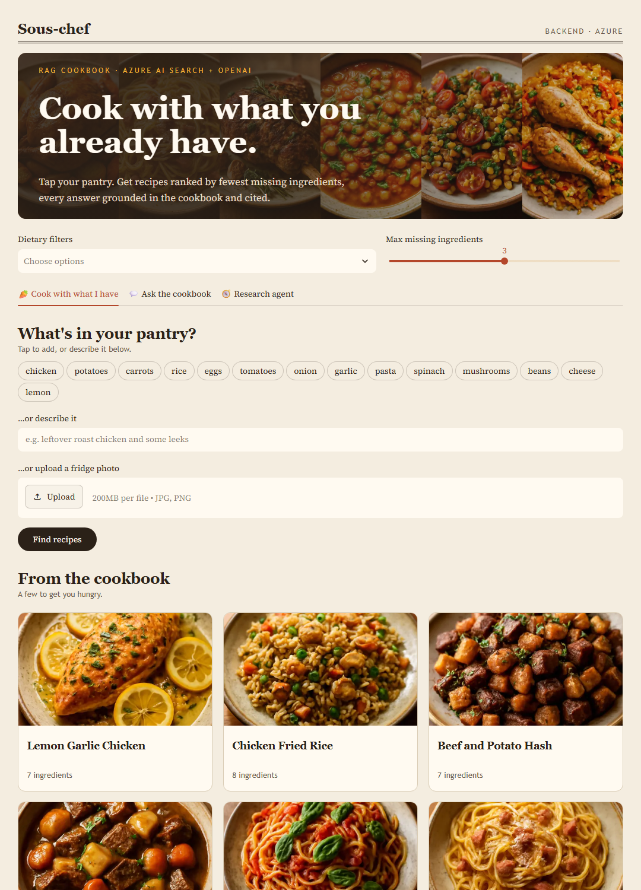

# Building Sous-chef: RAG that ranks recipes by what you are missing

*Publication draft for a blog post or LinkedIn article. Review the wording and current deployment costs before publishing.*

[Try the demo](https://ca-sous-chef-pqx3s64cfzndu.grayocean-96ef41ba.eastus2.azurecontainerapps.io) · [Source code](https://github.com/silent-vector-26/sous-chef-rag-cookbook)

## A cooking question with an engineering twist

"What can I cook with chicken, potatoes and carrots?"

That sounds like a similarity-search problem. But the most relevant recipe is not necessarily the most useful one: it might require eleven more ingredients. I wanted an assistant that optimizes for something concrete: **the fewest additional ingredients to buy**.

I built Sous-chef as an AI engineering portfolio project. It combines grounded Q&A, domain-specific ranking, multimodal input and a tool-calling agent, with an offline backend, evaluation harness and a reproducible Azure deployment.



## Let the model understand language; let code make the ranking decision

For pantry search, Azure OpenAI turns a message into normalized ingredient names. Azure AI Search retrieves recipes with ingredient overlap, and Python sorts the candidates by:

```text
(missing ingredient count, -owned ingredient count, -retrieval score, title)
```

Salt, pepper, water and oil are treated as staples. The same candidate pool supports a shopping list and suggestions such as "buy onion to make more recipes fully cookable."

This separation matters. The LLM helps interpret language; it does not invent the ordering. Normalization, tie-breaking, dietary filters and missing-ingredient counts can be tested independently of a model.

The ordering is deterministic **within the retrieved candidate pool**. It is not a promise of a globally optimal meal across every possible recipe.

## Two retrieval paths, not one generic chatbot

For cooking questions, the app uses Azure AI Search hybrid retrieval: BM25 plus 1536-dimensional embeddings from `text-embedding-3-small`, followed by semantic reranking. A source-constrained prompt asks `gpt-5.4-mini` to cite recipe IDs and refuse when the sources do not answer the question.

Pantry search uses ingredient filtering and deterministic ranking instead. This is a useful RAG lesson: a domain query does not always need the same retrieval strategy as a natural-language question.

The Azure deployment also includes:

- **A vision path:** uploaded food photos become ingredient lists for the pantry ranker.
- **A bounded agent:** the model can call `search_recipes` and `find_by_ingredients` across a limited number of steps. The UI shows the tool trace, not hidden model reasoning.
- **Input checks:** Q&A and pantry-text parsing use Azure AI Content Safety when configured, with a lightweight heuristic in offline mode.

The controls are not universal: the agent's top-level prompt, its direct search tool and image extraction do not all share that safety gate. That is a production-hardening item, not something I would hide behind a "responsible AI" badge.

## Making the engineering visible in the interface

The interface combines an editorial cookbook layout with pantry-first interaction: ingredient chips, free text, optional photo upload and recipe tiles.

Each result tile contains its image, missing-ingredient badge and expandable instructions, along with owned/missing ingredients and the source. There is no separate recipe list to cross-reference.


The 205 food images were generated once offline with `gpt-image-1-mini`, resized to 512px WebP and bundled with the app. They total about 5.2 MB. Viewing a recipe does not trigger image generation. The photos are illustrative, not evidence that the recipe has been cooked or tested.

One UI regression reinforced the need for backend-aware tests: the featured gallery initially read a local-only `store.recipes` attribute, which failed on Azure. The gallery now loads the bundled cookbook independently, and Streamlit regression tests run against the shared store interface in both backend configurations.

## Deployment, identity and cost are part of the demo

The infrastructure is defined in Bicep and deployed with `azd`. GitHub Actions validates pull requests; after a merge to `main`, successful CI triggers provisioning, deployment, indexing and an HTTP availability check.

Azure service access uses Entra ID. The running app has Search Index Data Reader, while the deploying principal has the permissions needed to manage and populate the index. The CI identity uses GitHub OIDC rather than a stored client secret. Custom OpenTelemetry spans expose retrieval, ranking, model usage and agent-tool operations in Application Insights.

To keep idle cost low, Search uses the Free tier and the Container App keeps `minReplicas: 0`. The approximate idle baseline is USD 5/month, mainly the container registry, before usage-related charges. Cold starts are an accepted trade-off for this demo.

Budget notifications are configured separately; they are alerts, not a spending cap. The exact one-time image-generation bill was not measured, and the temporary image-generation resource was deleted afterwards.

For production, I would reconsider capacity, availability, public-access controls and quality targets rather than simply scaling the demo unchanged.

## What the evaluation tells me, and what it does not

The corpus has 205 recipes: 25 hand-written and 180 LLM-generated. The golden set contains 13 answerable questions, seven expected refusals (including three injection attempts) and five pantry cases.

Previously recorded Azure runs produced:

| Metric | Recorded result |
|---|---|
| Retrieval recall@5 / MRR | 1.00 / 1.00 |
| Refusal on unanswerable and injection cases | 1.00 |
| Pantry top-1 / sorted by missing count | 1.00 / 1.00 |
| Expected-source citation rate | 0.92 reported; varies by run |

These are encouraging integration results, not a general RAG benchmark. The set is small and closely related to a synthetic corpus.

The metric called `citation_accuracy` in the evaluator checks whether the expected source appears in the answer's citation list. It does **not** evaluate support for every claim, and the current citation code can fall back to the top retrieved source. Claim-level groundedness would need a stronger evaluator.

The offline backend deliberately uses heuristic parsing and extractive answers. It is useful for repeatable development, but its recorded refusal rate is only 0.57. A green local CI run is not proof of Azure answer quality; the evaluator currently reports metrics rather than enforcing thresholds.

## What I would improve next

Before treating this as a production application, I would broaden the corpus with rights-cleared, independently reviewed recipes; expand the evaluation with held-out and adversarial cases; validate claim-level support; and apply consistent safety and dietary controls across all entry points.

The photo workflow also needs evaluation on real fridge images. The release smoke check used a generated plated-food fixture to exercise upload, extraction and ranking, not to measure recognition accuracy in a crowded fridge. That path succeeded, but repeated browser checks also exposed an intermittent HTTP 400 during upload, now tracked in [#13](https://github.com/silent-vector-26/sous-chef-rag-cookbook/issues/13). I would resolve that reliability issue before presenting uploads as consistently available.

The main lesson is not "put an LLM in front of search." It is to choose what the model should do, keep domain rules explicit, measure the behavior, and document the boundaries as carefully as the features.

## Explore the project

- [Live demo](https://ca-sous-chef-pqx3s64cfzndu.grayocean-96ef41ba.eastus2.azurecontainerapps.io) — allow for a cold start.
- [Repository and quick start](https://github.com/silent-vector-26/sous-chef-rag-cookbook)
- [Software design and Mermaid diagrams](SDD.md)
- [Requirements and traceability](SRS.md)
- [Nine technical walkthroughs](../cookbook/01-chunking-and-extraction.md)
